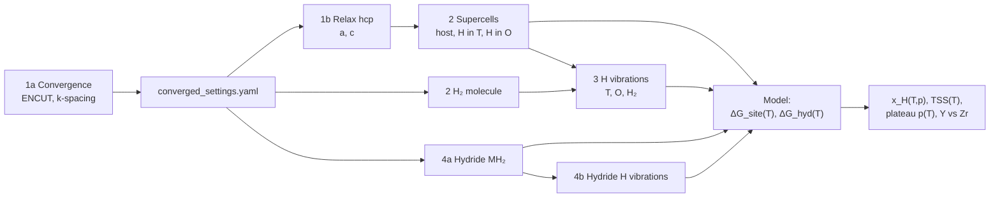

# Overall Scheme

**Question.** Why is hydrogen far more soluble in α-Y than in α-Zr?
**Strategy.** Compute, with identical DFT settings for both metals, every free-energy term that
decides where a hydrogen atom prefers to be — dissolved in the metal, in a hydride, or in H₂ gas —
and combine them in one thermodynamic model whose output can be compared with experiment.

## The chain at a glance

## Calculation matrix

| Stage | Campaign file | Per metal (Y, Zr) | Shared | Provides |
|---|---|---|---|---|
| 1a | `stage1_convergence.yaml` | 15 static runs, 2-atom cell | – | converged ENCUT and k-point spacing |
| 1b | `stage1_relax.yaml` | `relax` (ISIF=3) | – | PBE lattice parameters a, c; bulk energy per atom |
| 2 | `stage2_h_energetics.yaml` | `host`, `hT`, `hO` in a 3×3×2 supercell | `H2_stage2_molecule` | static solution energies ΔE_T, ΔE_O |
| 3 | `stage3_vibrations.yaml` | `vib_hT`, `vib_hO` | `H2_stage3_vib_molecule` | zero-point energy and vibrational free energy of H |
| 4a | `stage4_hydrides.yaml` | `hydride` (fluorite MH₂) | – | hydride formation energy per H |
| 4b | `stage4_hydride_vibrations.yaml` | `vib_hydride` | – | vibrational free energy of H in the hydride |
| 5 | `hsol analyze solubility` | – | – | site occupancies, TSS(T), Sieverts curves, plateau pressure |

Run ids are `<system>_<stage>_<label>`, e.g. `Zr_stage2_hT`; the analysis finds runs by these ids.

## Equations

All quantities are per H atom and referenced to ½ H₂, so a negative value means hydrogen prefers
the solid. Site types *s* are tetrahedral (T, *n*_T = 2 per metal atom) and octahedral
(O, *n*_O = 1 per metal atom) in hcp.

**Static solution energy** (Stage 2)

$$
\Delta E_s = E(\mathrm{M}_{36}\mathrm{H}_s) - E(\mathrm{M}_{36}) - \tfrac12 E(\mathrm{H}_2)
$$

**Free energy of dissolved H** (Stage 3 adds the harmonic H modes, metal atoms fixed)

$$
\Delta g_s(T) = \Delta E_s + F_\mathrm{vib}^{\,s}(T) - \tfrac12 F_\mathrm{vib}^{\,\mathrm{H_2}}(T)
$$

$$
F_\mathrm{vib}(T) = \sum_i \left[\tfrac12\hbar\omega_i + k_BT\ln\!\left(1-e^{-\hbar\omega_i/k_BT}\right)\right]
$$

At *T* = 0 the vibrational term is the zero-point-energy correction ΔZPE_s.

**Hydrogen gas** (ideal gas; translational and rotational part, per H)

$$
\Delta\mu_\mathrm{H}(T,p) = \tfrac12\left[\mu_\mathrm{trans}(T,p) + \mu_\mathrm{rot}(T)\right]
$$

**Dissolved concentration in equilibrium with gas** (lattice gas of independent H)

$$
\theta_s = \frac{1}{1+\exp\!\left[\left(\Delta g_s - \Delta\mu_\mathrm{H}\right)/k_BT\right]},
\qquad
x_\mathrm{H} = \sum_s n_s\,\theta_s \;\xrightarrow{\;\text{dilute}\;}\; \propto p^{1/2}\ \text{(Sieverts' law)}
$$

**Hydride** (Stage 4; MH₂ cell with *n*_M metal and *n*_H hydrogen atoms)

$$
\Delta g_\mathrm{hyd}(T) = \frac{E(\mathrm{MH_2\ cell}) - n_\mathrm{M}\,\varepsilon_\mathrm{M} - \tfrac{n_\mathrm{H}}2 E(\mathrm{H_2})}{n_\mathrm{H}}
+ \frac{F_\mathrm{vib}^\mathrm{hyd}(T)}{n_\mathrm{H}} - \tfrac12 F_\mathrm{vib}^{\,\mathrm{H_2}}(T)
$$

with ε_M the bulk energy per metal atom from Stage 1b.

**Terminal solid solubility.** At the solvus, dissolved H coexists with hydride, so Δμ_H is
replaced by Δg_hyd and the gas drops out:

$$
x_\mathrm{TSS}(T) = \sum_s \frac{n_s}{1+\exp\!\left[\left(\Delta g_s - \Delta g_\mathrm{hyd}\right)/k_BT\right]}
\approx \sum_s n_s\, e^{-(\Delta g_s-\Delta g_\mathrm{hyd})/k_BT}
$$

**Plateau pressure** (gas + solution + hydride coexist): Δμ_H(*T*, *p*_plat) = Δg_hyd(*T*).

**How the answer is read.** The TSS is controlled by the gap Δg_site − Δg_hyd: the smaller
the penalty for keeping H dissolved rather than in the hydride, the higher the solubility. The
analysis reports this gap for both metals and splits it into static and vibrational parts, which is
the quantitative form of the explanation the project is after.

## Why the calculations are set up this way

| Choice | Reason |
|---|---|
| One set of PREC/ISMEAR/SIGMA/LASPH/POTCARs for everything (`common_settings.yaml`) | Energies of different cells are only subtracted meaningfully if computed identically. |
| Convergence on the 2-atom primitive cell, static | Cheap, and isolates basis-set and k-point errors from geometry. |
| k-points as a *spacing* (VASP KSPACING convention) | The converged density transfers exactly to supercells and hydrides. |
| Supercells built from the relaxed Stage-1b lattice | All energies refer to the PBE equilibrium volume of each metal. |
| Cell fixed (ISIF=2) for H in the supercell | Dilute limit: one H does not change the macroscopic lattice parameter. |
| Positive EDIFFG for ISIF=3 relaxations | Forces vanish by symmetry; an energy criterion lets the cell actually relax. |
| Only H atoms displaced in finite differences | H modes (~100–200 meV) dominate the correction; metal modes change little. |
| Asymmetric vacuum box and Gaussian smearing for H₂ | Avoids spurious symmetry and smearing artefacts for a molecule. |
| Relaxed final H site checked by coordination (4 = T, 6 = O) | An O-site start that relaxes to T must not be counted as an O site. |

## Assumptions and limitations

- Ideal lattice gas: no H–H interaction. Adequate in the dilute limit; α-Y measurements reach
  H/Y ≈ 0.2 (`maeda1993_diffusivity_solubility_y`), where H–H pairing (`liu1989_h_pairing_y`) and
  the concentration dependence reported by `maeda1994_concentration_effects_y` become relevant.
- Harmonic H vibrations with a fixed metal lattice; host phonons are assumed unchanged by H.
- Ideal-gas H₂ with a rigid rotor; validated against NIST entropies to < 0.5 % (≤ 3 meV per H in
  *T*·*S* up to 1000 K, see `tests/test_thermo.py`).
- Hydride = cubic fluorite MH₂ by default. This is the YH₂ structure; for Zr the precipitating phase
  is δ-ZrH₁.₅–₁.₇ (stoichiometric ε-ZrH₂ is tetragonal), so the Zr hydride energy is an
  approximation. Other structures can be supplied with `builder: file`.
- No hydride/matrix interface or elastic accommodation energy, which shifts measured Zr TSS values
  and causes dissolution/precipitation hysteresis (`huang2019_alpha_zr_zrh_interface`).
- PBE errors (absolute H₂ binding, hydride formation energies) partly cancel in the Y-vs-Zr
  comparison but not in absolute solubilities; compare trends first, absolute values second.

The longer derivations are in [Scientific Foundation](scientific_foundation.md); the commands that
produce each term are in [Workflow](workflow.md).
